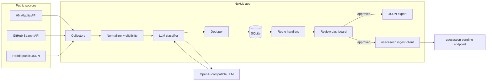
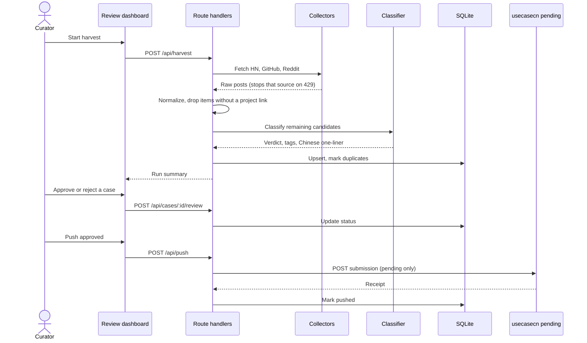

# Design Document

## Overview

AI Case Harvester is a single Next.js application that stitches three unlike parts into one body:

1. **Collectors** pull public JSON from Hacker News (Algolia), GitHub (Search API), and Reddit (`.json` listings).
2. **A classifier** sends each eligible candidate to an OpenAI-compatible LLM, which returns a real-case verdict, usecasecn category, tool tags, and a one-line Chinese summary. A deterministic deduper then collapses items by canonical repository or project URL.
3. **A Halloween-themed review dashboard** lets a curator approve or reject cases. Approved cases can be downloaded as JSON or POSTed into the usecasecn pending intake. The harvester never publishes.

The shape of the solution is deliberately small: one TypeScript process, one SQLite file, no queue broker, no microservices. A harvest run can be started from the dashboard or a CLI. Review happens in the browser. Push and export are explicit curator actions.

## Architecture





## Components and Interfaces

### Collectors

Each source implements the same port:

```ts
interface HarvestQuery {
  since: Date;
  limit: number;
  query?: string;
}

interface RawCandidate {
  source: "hn" | "github" | "reddit";
  sourceId: string;
  sourceUrl: string;
  title: string;
  author: string;
  excerpt: string;
  discoveredUrls: string[];
  createdAt: string; // ISO 8601
  raw: unknown;
}

interface SourceCollector {
  readonly source: RawCandidate["source"];
  collect(query: HarvestQuery, ctx: RequestContext): Promise<CollectResult>;
}

interface CollectResult {
  items: RawCandidate[];
  stoppedOnRateLimit: boolean;
  retryAfterSeconds?: number;
  fetched: number;
  failed: number;
}
```

- **HN collector** — `GET https://hn.algolia.com/api/v1/search_by_date` with a query aimed at shipped AI work (for example `AI OR ChatGPT OR LLM` plus story type). It follows Algolia's public search terms and stays within a conservative page size.
- **GitHub collector** — official Search API (`/search/repositories` and/or `/search/issues`) for recently created or discussed repositories that mention AI tooling in the description or README snippet. An optional `GITHUB_TOKEN` is used only to raise public rate limits.
- **Reddit collector** — public listing JSON such as `https://www.reddit.com/r/{sub}/new.json`, limited to a small, configurable set of public subreddits (for example `LocalLLaMA`, `MachineLearning`, `ChatGPTCoding`). No login, no Reddit API app flow.

`RequestContext` carries a shared `HttpClient` that injects User-Agent, per-source delay, and the 429 stop rule.

### Normalizer and eligibility

`normalize(raw: RawCandidate): Candidate` extracts a `projectUrl` from `discoveredUrls` (prefer a git hosting repo, then a demo or product URL, never a bare vendor homepage). Items without a project URL, or that fail the real-case pre-filter heuristics (job posts, hiring threads, generic "what's your favorite model" questions), are stored as `rejected_prefilter` and never reach the LLM.

### Classifier

```ts
interface LlmClient {
  completeJson(input: { system: string; user: string }): Promise<unknown>;
}

interface Classification {
  isRealCase: boolean;
  confidence: number; // 0..1
  category: UsecasecnCategory;
  tools: string[];
  summaryZh: string;
  rationale: string;
}
```

`OpenAiCompatibleClient` is the only production `LlmClient`. It reads `LLM_BASE_URL`, `LLM_API_KEY`, and `LLM_MODEL`. Prompts instruct the model to return strict JSON, to use the official usecasecn categories, and to write the one-line summary in Chinese. The classifier does not receive the ingest token or any other secret.

### Deduper

Canonicalization rules:

- Repository: `host/owner/repo` lowercase, strip `.git` and `/tree|/blob|/issues/...`.
- Other URLs: lowercase host, drop default ports, drop trailing slash, drop `utm_*`, `ref`, `fbclid`, `si`.

Lookup is against `cases.canonical_key`. On hit, the new row is stored as `duplicate` with `duplicate_of_id` set; source URLs are appended to `related_sources` on the primary row.

### Persistence

`src/lib/db.ts` opens a SQLite file at `DATABASE_PATH` (default `./data/harvester.db`) with `better-sqlite3`. Schema migrations are plain SQL applied in order on startup. No in-memory fallback when a production path is configured.

### HTTP API

| Method | Path | Purpose |
| --- | --- | --- |
| `POST` | `/api/harvest` | Run collectors → classify → dedupe. Body may limit sources and `since`. |
| `GET` | `/api/cases?status=&source=&category=` | List cases for the dashboard. |
| `POST` | `/api/cases/:id/review` | `{ "decision": "approved" \| "rejected", "reason": "?" }` |
| `GET` | `/api/export?status=approved` | Download JSON. |
| `POST` | `/api/push` | Push selected or all approved cases to usecasecn pending intake. |

All mutating routes are local-first: the default deployment is loopback. If the app is ever exposed, a later change can add a simple shared-secret header; that is out of scope for the hackathon skeleton.

### Review dashboard

`/review` is a server-rendered page with a client island for filters and actions. Visual language: near-black background, bone-colored text, pumpkin orange and muted purple accents, a "graveyard" queue metaphor. Visible action labels remain **Approve** and **Reject** so the data model stays unambiguous; the theme is decorative, not a second vocabulary for status.

### Export and ingest

`toUsecasecnSubmission(case): Submission` maps a local case into the usecasecn v1 payload (`schema_version`, `title`, `summary`, `author`, `source_url`, `project_url`, `tools`, `category`, `evidence`, optional `one_liner` / `batch_id`).

The ingest client:

- Reads `USECASECN_API_URL` and `USECASECN_INGEST_TOKEN`.
- Sends `Authorization: Bearer <token>`, `Idempotency-Key`, and `User-Agent: ai-case-harvester/0.1`.
- Never logs the token. Error messages show only status codes and sanitized body text.
- Stops the remaining push batch when the intake returns 429.
- Treats 409 as a recorded duplicate, not a crash.
- Uses official source URL kinds (HN item, GitHub repo). Reddit threads are evidence, not `source_url`, when the schema does not list Reddit.

Author sanitization: trim whitespace and trailing hyphens or other punctuation that has caused 422 responses. If the author is empty after sanitization, the push is skipped and the dashboard shows a validation error.

### CLI

`npm run harvest` invokes the same orchestration function as `POST /api/harvest`, for demo and cron-style use.

## Data Models

```ts
type SourceName = "hn" | "github" | "reddit";

type CaseStatus =
  | "harvested"
  | "rejected_prefilter"
  | "classified"
  | "needs_review"
  | "duplicate"
  | "approved"
  | "rejected"
  | "exported"
  | "pushed";

type UsecasecnCategory =
  | "生活与旅行"
  | "兴趣与娱乐"
  | "个人创作"
  | "学习与成长"
  | "工作与效率"
  | "其他";

interface CaseRecord {
  id: string;
  source: SourceName;
  sourceId: string;
  sourceUrl: string;
  projectUrl: string | null;
  canonicalKey: string | null;
  title: string;
  author: string;
  excerpt: string;
  isRealCase: boolean | null;
  confidence: number | null;
  category: UsecasecnCategory | null;
  tools: string[];
  summaryZh: string | null;
  rationale: string | null;
  status: CaseStatus;
  duplicateOfId: string | null;
  relatedSources: string[];
  reviewedAt: string | null;
  rejectReason: string | null;
  ingestReceiptId: string | null;
  ingestStatus: string | null;
  createdAt: string;
  updatedAt: string;
}

interface HarvestRun {
  id: string;
  startedAt: string;
  finishedAt: string | null;
  perSource: Record<SourceName, { fetched: number; kept: number; failed: number; stoppedOnRateLimit: boolean }>;
  error: string | null;
}
```

SQLite tables: `cases`, `harvest_runs`, plus a `schema_migrations` table. `tools` and `related_sources` are stored as JSON text with a unique index on `(source, source_id)` and a unique index on `canonical_key` where status is not `duplicate`.

## Error Handling

| Failure | Response |
| --- | --- |
| Missing `LLM_*` env | Classification aborts; harvest result is `partial` with already stored raw candidates left in `harvested`. |
| LLM timeout or invalid JSON | That candidate is left in `harvested` with an error note; the run continues. |
| HTTP 429 from a source or intake | Stop further calls to that API in this run; persist work done; surface `Retry-After` in the run record. |
| HTTP 401/403 or a login wall | Skip the request; do not invent credentials or rotate User-Agent. |
| Missing ingest env on push | Refuse the push; export remains available. |
| Ingest 422 | Keep the case `approved`, store the validation message (no secrets), allow a later retry after a local edit. |
| Ingest 409 | Record as already present; mark local case `pushed` only if a receipt id is returned, otherwise `approved` with a conflict note. |
| SQLite open failure | Process exits (CLI) or API returns 500; no hidden in-memory database. |
| Secret accidentally interpolated into a log line | Logging helper redacts bearer tokens, `sk-` prefixes, and values of known env secret names. |

## Testing Strategy

- **Unit tests (Vitest)** for URL canonicalization, eligibility rules, author sanitization, usecasecn payload mapping, log redaction, and the 429 stop / `Retry-After` parser. These must not call the network or a live LLM.
- **Collector tests** against recorded JSON fixtures (HN Algolia, GitHub search, Reddit listing). No live calls in CI.
- **Classifier tests** with a fake `LlmClient` that returns canned JSON, including malformed output.
- **API tests** with a temporary SQLite file: harvest orchestration (mocked collectors + LLM), review state machine, export shape, and push client (mocked HTTP).
- **Secret tests** assert that a thrown error or log line containing a token is redacted.
- Manual dashboard review (theme, empty state, approve/reject) is not a `tasks.md` item; it is covered by the demo script.

## Tech Stack

**Chosen stack: TypeScript + Next.js (App Router) + SQLite + Tailwind CSS.**

| Piece | Choice | Why |
| --- | --- | --- |
| Language | TypeScript | One language for collectors, classifier client, API, and UI. |
| Web framework | Next.js App Router | The review dashboard is a first-class deliverable. Route handlers and pages share the domain layer. One `npm run dev` for the whole demo. |
| Database | SQLite via `better-sqlite3` | Zero-ops local persistence. Synchronous, simple, enough for thousands of cases. |
| CSS | Tailwind CSS | Fast path to a dark Halloween theme without a design system. |
| Validation | Zod | Runtime parsing of LLM JSON, env, and ingest payloads. |
| Tests | Vitest | Fast unit tests that hooks can run on save. |
| HTTP | Native `fetch` | Collectors are GET-and-parse JSON; no scraping browser is required. |

**Why not Python FastAPI + SQLite?** FastAPI would be a slightly thinner backend for the collectors, but the Halloween dashboard would then be a second app or a set of templates with a weaker component model. For a hackathon demo whose third "organ" is a visual review desk, one TypeScript app is the smaller design.

**Out of scope for v1:** authenticated multi-user review, background job workers, browser-based scraping, X/YouTube/V2EX collectors, automatic publishing, and any bypass of source-site risk controls.
